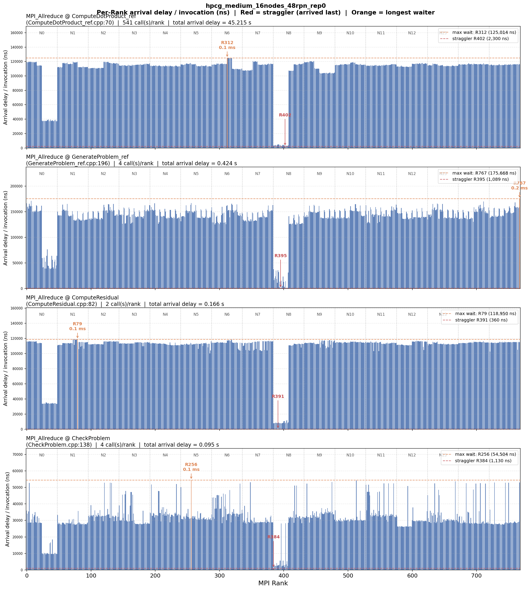
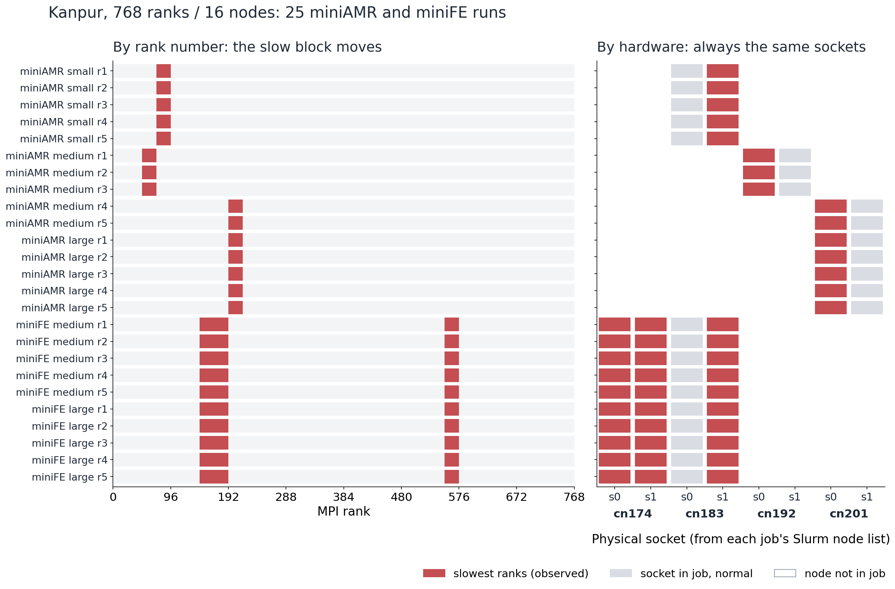
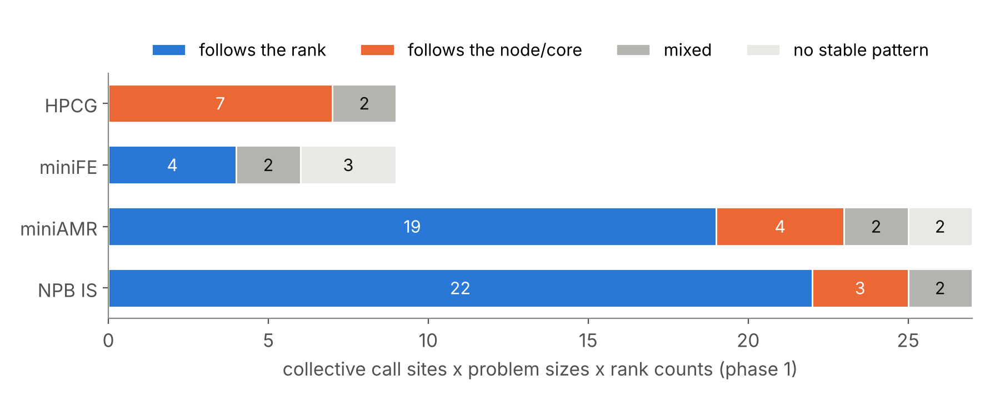
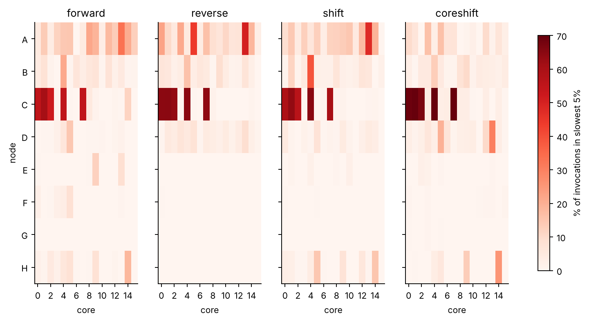
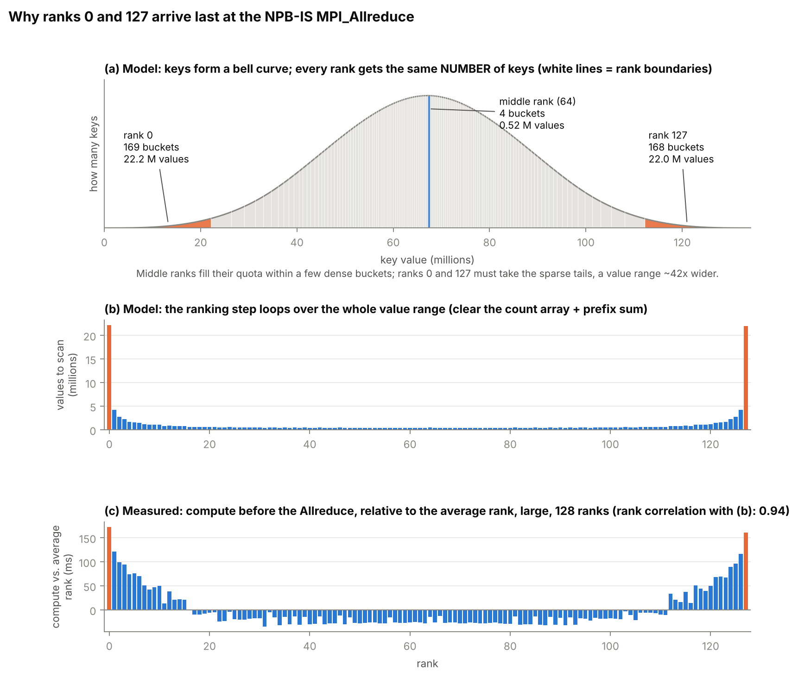

# Why are some MPI ranks always late?

Every MPI collective waits for its slowest rank. When the same ranks are late again and again, they set the run time for everyone. This work finds those ranks from MPI traces and works out **why** they are late: the application's own work or the hardware they run on.

> **Note:** this repository presents selected results from ongoing research with Prof. Preeti Malakar (IIT Kanpur). The full analysis is being prepared for publication, so the tracer, the methods in detail and the raw traces are not included. See [Contact](#contact).

**What is measured.** For every call of a collective, each rank's waiting time is `T_delay(r) = arrival of the last rank − arrival of rank r`. A rank that is consistently last is a straggler. The traces come from IPMPI, a PMPI tracer that records every MPI call with its source-line call site.

## Key findings

| # | Finding | Evidence |
|---|---|---|
| 1 | Degraded hardware can be found from MPI traces alone | 768-rank production cluster |
| 2 | On healthy machines, most stragglers come from the application | 825 traced runs on AWS |
| 3 | With balanced work, even a 3–5% slower core decides who is late | HPCG |
| 4 | A straggler can be traced to the source lines that cause it | NPB IS |

## 1. Degraded hardware can be found from MPI traces alone

On a production cluster (768 ranks, 16 nodes), the stragglers stand out in a single run as whole blocks of ranks that arrive last at every collective:

Across jobs, these blocks were different rank numbers each time but always on the same physical CPU sockets: six degraded sockets with about **2× slower compute**. Knowing them, the straggling ranks of a new job could be **predicted from its node list** before looking at its trace.

The slowdown appeared only when the problem no longer fit in cache, which pointed to degraded memory bandwidth on those sockets; per-socket STREAM measurements confirmed it.

## 2. On healthy machines, most stragglers come from the application

To separate the rank from the hardware it runs on, every experiment was repeated with the ranks moved across nodes and cores: **825 traced runs** of HPCG, miniFE, miniAMR and NPB IS at 32–128 ranks on a dedicated 8-node AWS cluster. Lateness that follows a rank wherever it runs comes from the rank's own work.

In miniAMR and NPB IS, lateness follows the rank in most cases (19 of 27 and 22 of 27). HPCG is the exception (finding 3).

## 3. With balanced work, a small hardware difference decides

HPCG gives every rank the same work. Its stragglers are a few cores of one node, whatever ranks are placed there: they spend **3–5% more time in compute** in all 120 runs, with the same instructions and clock speed as the other cores.

## 4. Tracing a straggler to the source code

In NPB IS, ranks 0 and P−1 are late at `MPI_Allreduce` in every run at the medium and large sizes. The cause is two loops of the integer sort: the ranks receive the same number of keys, but the edge ranks cover a **~42× wider value range**, and the loops scale with that range. At the largest size this costs them **up to 350 ms per iteration**.

## Contact

To discuss the work, email Swastik Bhandari at swastik3223@student.ku.edu.np.

## Acknowledgements

This work was carried out under the mentorship of Prof. Preeti Malakar (IIT Kanpur).

## License

Code: MIT. Figures and text: CC BY 4.0.
