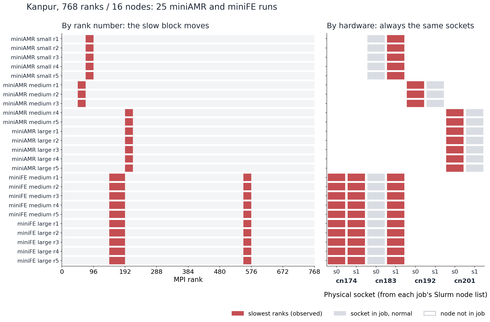
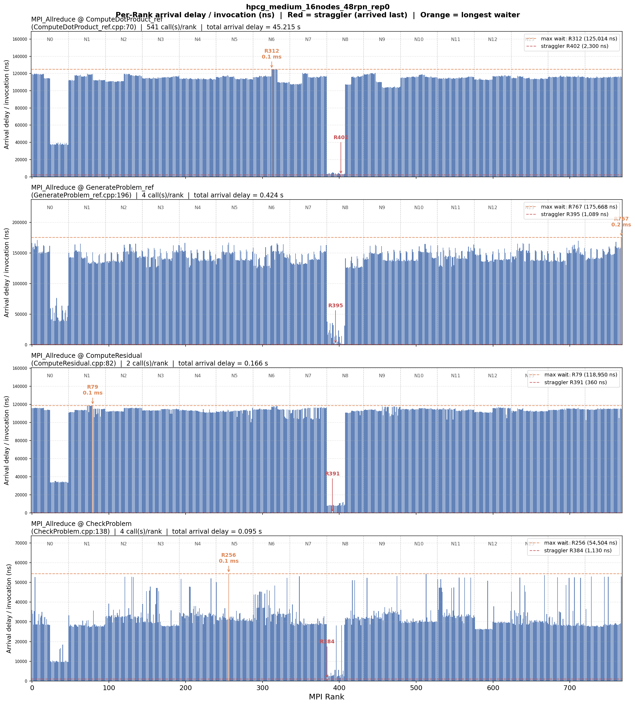
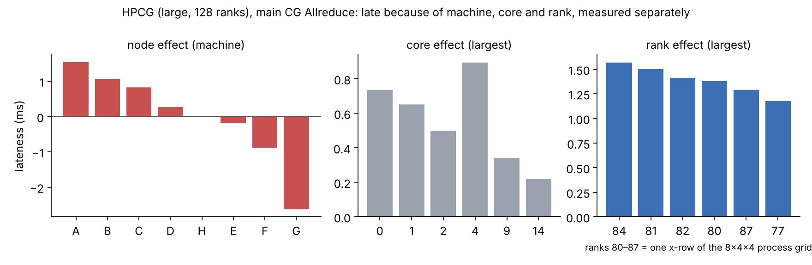
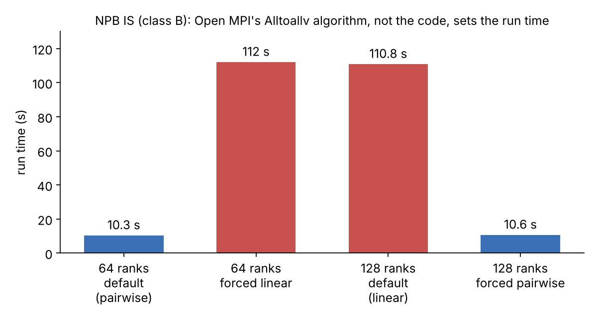
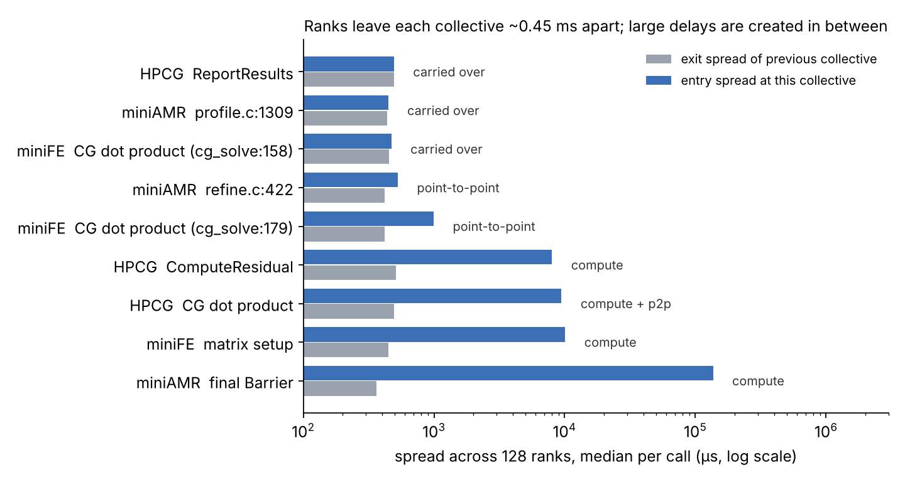

# Why are some MPI ranks always late?

In a parallel program, every collective operation (`MPI_Allreduce`, `MPI_Barrier`, ...) waits for the slowest rank.
When the same ranks are late again and again, they set the run time for everyone. This repository finds those ranks
from MPI traces and works out **why** they are late: the application's own work, the machine they run on, the CPU core,
or the MPI library itself.

The traces come from **IPMPI**, a PMPI tracer that records every MPI call per rank with its source-line call site.
> **Note:** This repository shows a selection of results. Most of this work is ongoing research and not yet
> published, so the tracer source and full data are not included. I'm happy to discuss it; see [Contact](#contact).

## What is measured

For every call of a collective and every rank *r*:

```
T_delay(r) = (arrival time of the last rank) - (arrival time of rank r)
```

`T_delay` is how long rank *r* waits for the slowest rank. A rank that is consistently last (T_delay ≈ 0 while
everyone else waits) is a **straggler**. Timestamps are corrected for clock offsets between nodes, measured before and
after every run.

## Findings

### 1. Slow hardware shows up as slow ranks

On a production cluster (768 ranks on 16 nodes), the late ranks were a different block of rank numbers in each job,
but always on the **same physical CPU sockets**. Mapping ranks to sockets with the job's node list showed six degraded
sockets with about 2× slower compute. Knowing the sockets, the straggling ranks of a new job could be predicted before
looking at its trace.



The effect appeared only when the problem no longer fit in cache, which pointed to degraded memory bandwidth on those
sockets. This was confirmed with `--exclusive` placement experiments and per-socket STREAM measurements.

<details>
<summary>Per-rank view of one run (HPCG, 768 ranks): the ranks of two nodes arrive last at every collective</summary>



</details>

### 2. Separating the rank, the machine and the core

A trace alone cannot tell whether rank 84 is late because of its work or because of the machine it ran on. On a
dedicated 8-node cluster (AWS c5.9xlarge, 16 ranks per node, Open MPI) every experiment was repeated with ranks placed
differently:

| Placement | What moves |
|---|---|
| forward / reverse / shift | rank blocks move to different machines |
| coreshift | ranks move to different cores inside each machine |

Lateness that follows a rank wherever it runs is a **rank effect** (its work). Lateness that stays with a machine or
a core is a **node** or **core effect**. A linear model (`lateness = run + rank + node + core`) gives the size of each.

Campaign: 4 applications (NPB IS, HPCG, miniFE, miniAMR) × 3 problem sizes × 32/64/128 ranks × all placements × 5
repetitions, 870 traced runs on the same 8 machines.



In HPCG all three act at once: one machine is ~1.5 ms late and another ~2.6 ms early per call, low-numbered cores are
late, and the latest ranks are one row of HPCG's process grid at every problem size. In NPB IS on a single node, the first and
last ranks are late because they own a wider key range; this was traced to two source lines (`is.c:831`, `is.c:842`).

### 3. The MPI library can create the straggler

At 128 ranks, NPB IS became 10× slower than at 64 ranks. At 128 ranks Open MPI's default rules pick the *linear*
`MPI_Alltoallv` algorithm instead of *pairwise*, and linear floods the receiving node over TCP (incast). Forcing the
algorithm either way shows it directly:



```bash
export OMPI_MCA_coll_tuned_use_dynamic_rules=1
export OMPI_MCA_coll_tuned_alltoallv_algorithm=2   # 2 = pairwise, 1 = linear
```

### 4. Compute or communication?

Ranks leave every collective about 0.45 ms apart. Comparing that **exit spread** with the **entry spread** at the next
collective shows where a delay is created. Equal spreads mean the delay was carried over from the previous collective.
A larger entry spread means it was created in between, and splitting that time into point-to-point MPI calls and
everything else gives the cause.



The large delays (milliseconds) are created by computation between collectives. The small ones (hundreds of µs) are
carried over or added by halo exchange.

## Repository

```
analysis/
  analyze_rank_delays.py   per-call-site T_delay per rank, summary tables
  plot_rank_delays.py      per-rank arrival delay plots (as in finding 1)
  plot_by_node.py          late ranks grouped by node
  plot_main_straggler.py   which rank is last, call by call
  plot_straggler_freq.py   how often each rank is the straggler
  plot_arrival_decomp.py   compute / point-to-point / idle split per rank
  plot_interval_gantt.py   timeline of the interval before a collective
  decomp_lateness.py       exit / point-to-point / compute split of lateness (finding 4)
figures/
  make_aws_figures.py      regenerates the AWS figures
```

Trace format, one file per rank (`comm_trace-<rank>.txt`):

```
func_name,start,end,src,dest,tag,msg_size,duration,callsite_id
```

Example:

```bash
python3 analysis/analyze_rank_delays.py <run_folder> --out-dir out/      # writes out/<run>_rank_delay_agg.csv
python3 analysis/plot_rank_delays.py out/<run>_rank_delay_agg.csv --ranks-per-node 16
python3 analysis/plot_straggler_freq.py <run_folder> --ranks-per-node 16
python3 analysis/decomp_lateness.py <run_folder> <callsite_id>
```

## Contact

To discuss the work, or for the IPMPI tracer code and the raw traces, email Swastik Bhandari at
swastik3223@student.ku.edu.np.

## Acknowledgements

This work was carried out under the mentorship of Prof. Preeti Malakar (IIT Kanpur).

## License

Code: MIT. Figures and text: CC BY 4.0.
